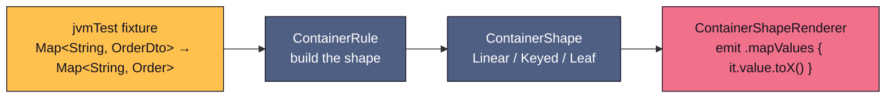

# Contributing

New to the codebase? Read [Architecture](architecture.md) first — 15 minutes gets you the mental model. This page shows what a real contribution looks like and where to start. Mechanics (detekt, commit format, test infrastructure, release process) live in [CONTRIBUTING.md](https://github.com/blu3berry-why/Kraft/blob/main/CONTRIBUTING.md) at the repo root.

## The dev loop

```bash
git clone https://github.com/blu3berry-why/Kraft.git
cd Kraft
./gradlew :kraft-ksp:jvmTest   # the full test suite
```

All behavior is specified by compile-testing tests in `kraft-ksp/src/jvmTest`: each test compiles a small fixture with the processor attached and asserts on the generated code or the compiler error. Write the test **first** — it is the fastest way to see the pipeline run end to end. Before writing one, skim the [KSP Compile-Testing Gotchas](ksp-compile-testing-gotchas.md); both gotchas on that page cost real debugging hours.

**Budget for detekt's size limits.** `detekt` runs in CI with `TooManyFunctions`,
`CyclomaticComplexMethod` and `ReturnCount` enabled. A new rule or renderer that grows past a
handful of private helpers, or a branching `when` over several kinds, will trip them. Plan the
helper-file split up front (e.g. `ContainerShapeBuilder.kt` / `MapKeyInjectivity.kt` beside
`ContainerRule.kt`) rather than discovering it at the end of the task. Prefer splitting over
`@Suppress`.

## Anatomy of a feature

How container mapping (`List`, `Set`, `Array`, `Map`, … nested to any depth) is wired — the template for most "support a new shape" features. One rule, one IR type, one renderer, one pass through the pipeline:



1. **Test first** — a fixture with a `Map<String, OrderDto>` property and an assertion on the generated mapper (`kraft-ksp/src/jvmTest/.../containers/`).
2. **Detection** (`descriptor/propertyresolver/rules/ContainerRule.kt`, `ContainerShapeBuilder.kt`) — recognise the container pair and build its shape; element operations come from `LeafOperationResolver`, shared with scalar properties.
3. **Model** (`model/descriptor/ContainerShape.kt`) — `ContainerKind` plus the `ContainerShape` tree carry the fact to the generator as `PropertyMappingStrategy.ContainerMapping`.
4. **Emission** (`kraft-ksp/.../ContainerShapeRenderer.kt`) — render the shape recursively inside the constructor call.

Notice the shape: *rule → IR → generator*, never a shortcut from rule to generator. If your change wants to skip the IR, it is probably in the wrong place.

## Good first contributions

- **Primitive arrays or `Sequence`** (`IntArray`, `Sequence<T>`) — out of scope for 0.14's container mapping; the same four touch points as the walkthrough above (a `ContainerKind` entry, detection, suffix/empty-value tables in the renderer).
- **Error-message improvements** — all compiler errors live in one file (`kraft-core/.../util/LoggerExtensions.kt`); making one clearer is a self-contained PR with an error-path test.
- **Docs fixes** — every page of this site is markdown under `docs/`; the site builds with `mkdocs serve`.

Check the [open issues](https://github.com/blu3berry-why/Kraft/issues) for what is currently wanted, and open one first for anything larger than the items above so the approach can be agreed before you build.
